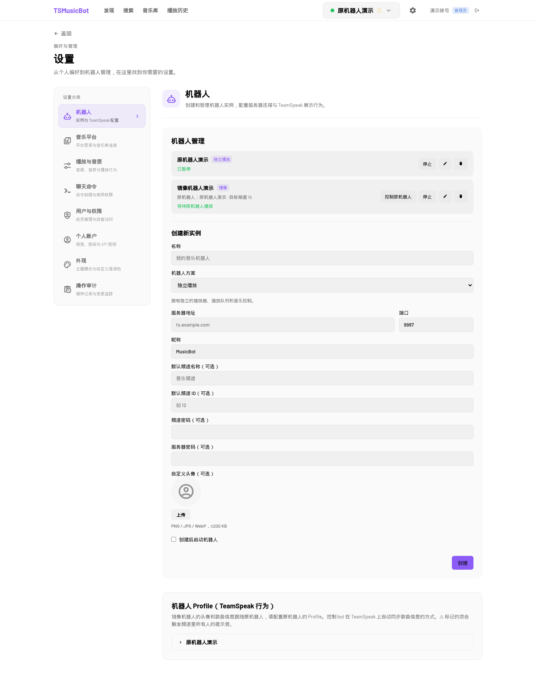

# Upstream comparison and mirror integration — 2026-10-15

This integration merges upstream `c26998d296c68af2a36046efe8a265f2a0bb4dd9`
(PR #176, settings and appearance) into the existing organization repository
based on `d3d788ef4e9c19421a5632ef6757625a47660e21`. Their common ancestor is
`28c128d0c954c4bd6fb3a5f33f00b33282033462`. Keeping that history is simpler
than recreating the repository and transplanting its mirror implementation.
The upstream MIT attribution and configurable Docker delivery are preserved.

## Playback repair choice

| Area | Upstream main | Integrated behavior |
| --- | --- | --- |
| Long Bilibili playback | Standard CDN backup preference, input-side seeking, reconnect and bounded stream recovery already present in the shared baseline | Retain these existing fixes |
| New `mountaintoys.cn` nodes | Does not classify the domain or add Bilibili request headers | Retain the tested `2e33086` domain/header repair and standard CDN priority |
| Latest upstream changes | Settings categories, system/manual theme and per-account accent preferences | Merge the complete changes; no Bilibili parser/player changes in this upstream delta |
| Mirror functionality | Independent music bots | Keep audio/avatar mirroring, relationship protection, fixed target channels, pause persistence and backend/frontend control restrictions |
| QQ lyric translation | Original provider | Keep the deployed `d3d788e` provider fallback/translation repair |

`upstream/fix/issue-161-bilibili-long-stream` (`07ad861`) is already an ancestor
of main; later upstream commits strengthened stream-session isolation,
diagnostics and recovery. Selecting that older branch would discard those
improvements. The latest upstream delta does not change `bilibili.ts`,
`player.ts`, their tests or `bot/instance.ts`. Replacing our playback files with
upstream versions would discard the new-domain repair without gaining a newer
Bilibili fix. This merge keeps the complementary improvements together.

## Merge compatibility

Both content conflicts are resolved by combining behavior:

- `App.vue` retains `MirrorNotice` and adds the upstream accent styling.
- The new Settings categories host the existing `BotManagement` component in
  the bots category. Its create/edit form, connected-instance locks, unavailable
  source protection and source navigation remain intact. Mirror profile editing
  continues to defer to the source bot.
- Custom mirror buttons use `--color-on-primary` so light accent colors retain
  readable text, as the upstream components now do.
- Theme initialization resolves explicit choices without a browser and uses a
  safe light fallback when no `window.matchMedia` exists. The actual browser
  continues to follow system changes. This fixes an upstream initialization
  assumption exposed by the existing mirror-control regression tests.
- The additive `users.accentColor` migration coexists with
  `bot_instances.mirrorSourceBotId` and `queue_state.paused`.

## Verification and deployment boundary

The production baseline when preparing this integration is `d3d788e`. This
record does not claim that the new integration has been deployed. A future NAS
update requires a new image-specific reviewed plan and preserves all live bot
identities, relationships, account data, cookies, media and queues.

A real temporary SQLite migration test constructs pre-accent account data and
existing source/mirror identities, fixed channels and a manually paused queue.
It verifies preservation, default appearance, user isolation, guest refusal
and persistence across repeated reopening. Existing mirror controls, bot/API
permissions, lyric and audio regression suites are also retained.

An isolated browser fixture verifies category visibility, mirror management,
connected mirror edit locks, light-accent text contrast, saved preferences on
reload, scoped mirror notice and guest appearance without management requests
or server writes. It uses demonstration accounts and local mocked endpoints;
it never changes a production queue. The screenshot below is that fixture,
not a production screenshot.

The first concurrent local build/test attempt exposed the missing browser-global
guard and several existing timing-test timeouts. The guard is fixed; the complete
suite passed serially: 91 files and 1514 tests, with the original timeout and
acceptance settings. The complete backend/Web build and all six browser
compatibility checks passed; the fixture produced no page errors. Final CI,
artifact verification and delivery revision are recorded against the actual
commit in the organization workflow and private change log. No checks are
removed or weakened for this merge.

## Rollback compatibility

Back up the live database and configuration before any approved deployment.
The appearance change adds a column; it does not replace bot or queue tables.
Retain the old image and all live data. Test rollback compatibility before
preparing the NAS plan; do not restore an old database over newer queue/account
changes or remove the new column merely to revert the image. Restart/recreation
interrupts playback and requires the applicable exact NAS confirmation.
